# Quick Access for Pass

**Fast, Touch-ID-protected access to your [Proton Pass](https://proton.me/pass) secrets from the macOS menu bar.** Press a hotkey, search, copy — done.

<p align="center">
  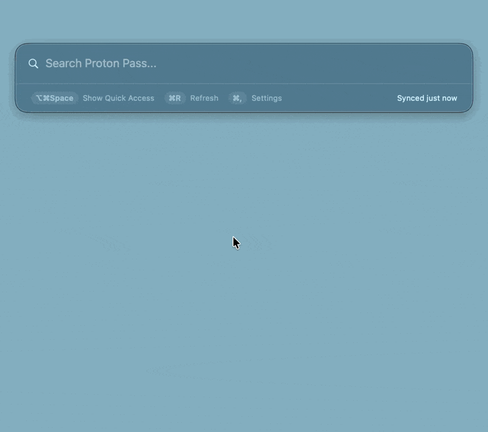
</p>

## Get started

For the simplest setup, download the signed app from [Releases](../../releases), open the DMG, and drag **Quick Access for Pass** to `/Applications`. The signed app includes Proton's official Pass CLI, so you do **not** need Homebrew, Terminal setup, or a separate CLI install.

If you manage apps with [Homebrew](https://brew.sh/), you can install Quick Access that way too:

```bash
brew install CiTroNaK/tap/quick-access-for-pass
```

Homebrew can fetch app updates through your normal `brew` workflow. Quick Access can also use an already installed Proton Pass CLI before falling back to the bundled helper; see [Proton Pass CLI integration](docs/pass-cli.md).

## Quick start

1. Open Quick Access for Pass.
2. Log in to Proton Pass CLI:
   - If a login notification appears, click **Log In**.
   - If notifications are disabled or you miss the notification, open Quick Access, press `⌘,`, then use **Settings → Pass CLI → Log In to Proton Pass CLI…**.
3. Press `⇧⌥Space`.
4. Search for a Proton Pass item.
5. Hit Return to copy the selected value.

If Quick Access needs a Proton Pass CLI session, the main panel shows a **Login** button in the sync status area so you can recover without leaving search.

<p align="center">
  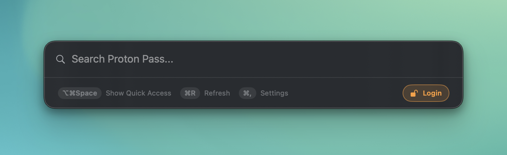
</p>

Everything else is optional configuration.

## What you get

- **Global-hotkey search** — open a floating search panel from anywhere with `⇧⌥Space` by default.
- **Fast local metadata search** — encrypted SQLite + FTS5 keeps ordinary search tables metadata-only. The sole persisted-secret exception is opt-in Offline Mode’s encrypted `offlineSnapshots` table; see the [security policy](SECURITY.md).
- **Non-blocking sync recovery** — if sync needs attention, search stays usable. Login-required states show **Login** in the sync status area, while sync diagnostics and skipped-item details open from **Show sync errors** in a separate window.
- **Keyboard-first actions** — copy usernames, passwords, TOTP codes, URLs, or fields with configurable shortcuts.
- **Touch ID protection** — unlock the app and authorize sensitive optional proxy actions with biometrics.
- **Clipboard safety controls** — concealed pasteboard type support and automatic clipboard clearing.
- **Large Type** — display selected values in a large temporary window when you need to read them aloud.
- **Optional SSH Agent Proxy** — gate Proton Pass SSH key signing behind Touch ID.
- **Optional Run Proxy** — inject Proton Pass secrets into commands through the bundled `qa-run` helper.
- **Optional System AutoFill (macOS 27+)** — offer Proton Pass passwords and current TOTP codes to Safari and compatible native apps without adding passkey handling.

## Quick Access panel

The core app is a small menu-bar utility for searching Proton Pass and copying values quickly.

- Default hotkey: `⇧⌥Space`
- Result navigation: `↑` / `↓`
- Open item detail: `→`
- Go back: `←`
- Run selected action: `Return`
- Copy Username: `⌘C`
- Copy Password: `⇧⌘C`
- Copy TOTP: `⌥⌘C`
- Open in Browser: `⌘O`
- Show in Large Type: `⇧Return`

All shortcuts can be changed in **Settings → Shortcuts**.

<table>
  <tr>
    <td align="center">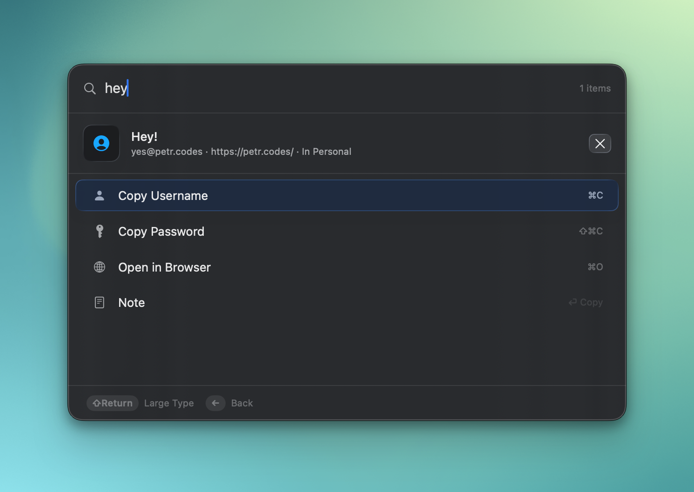<br><sub>Item detail with per-field copy actions</sub></td>
    <td align="center">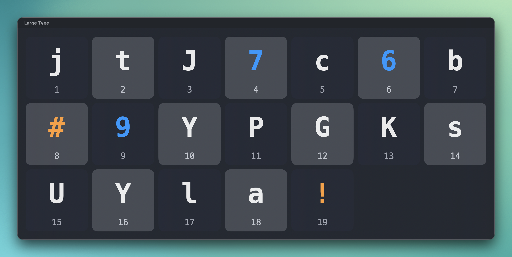<br><sub>Large Type display, handy when reading a password aloud</sub></td>
  </tr>
</table>

## Why trust it?

Quick Access is built around a few security constraints:

- **Metadata stays separate from secrets** — ordinary local SQLCipher tables store only search metadata.
- **Offline access is explicit** — select an individual item with **Make available offline**, or explicitly select a whole vault in **Settings → Offline** to cache its current and future items after successful sync. Selecting a vault stores encrypted offline copies of all its items on this Mac. New items added to selected vaults will also become available offline after syncing. Individual removals stay excluded from whole-vault caching until selected again; turning off a vault preserves individually selected items. You can **Keep offline individually** for a vault-cached item. A v11 upgrade preserves existing selected copies as individual selections; old vault permissions do not become whole-vault consent. Offline Mode uses the existing app authorization policy and does not add a mandatory Touch ID, Secure Enclave, or hardware gate.
- **Selected offline snapshots are encrypted in the same host-only database** — the unified SQLCipher file has 12 migrations; only the dedicated `offlineSnapshots` table may contain selected full secrets, protected again with an authenticated AES-GCM snapshot cipher and a device-bound Keychain key. Whole-vault selection is a policy choice, not a promise that every copy succeeded: failed initial copies remain selected and unavailable until retry, while failed refreshes retain the previous complete snapshot. No second offline database, legacy transfer, compatibility reader, or automatic legacy cleanup is used.
- **Offline data has whole-file trade-offs** — backup exclusion applies to the unified database file, including local Run profiles and remembered decisions. Device-bound keys make selected snapshots non-portable. Logical deletion retains snapshot keys and requests a bounded best-effort WAL checkpoint to reduce active-file remnants; it does not promise forensic secure erasure, cryptographic shredding, APFS-snapshot removal, or removal from manual/third-party backups.
- **Cached values are preferred** — Items and vaults enabled for Offline Mode use cached values when a usable copy is available. Sync is needed to refresh them. Without a usable cached copy, Quick Access uses Pass CLI. Offline copies are used for copy actions, Large Type, and System AutoFill. SSH Agent and Run proxies do not use offline copies.
- **You stay in control** — **Settings → Offline** shows selected/usable counts and a **Manage offline items…** button. The manager keeps long lists in a bounded, scrollable sheet grouped by vault, with metadata-only search (including usernames and email addresses), available/stale/unavailable status, last successful refresh times, and individual Keep/Retry/Remove actions. Retry refreshes only that selected item. Removing all offline data remains available in the main Offline pane. Failed refresh preserves the previous complete snapshot. Request ownership and atomic publication prevent obsolete fetches from recreating removed selections; a completed commit is not undone by late cancellation. Startup recovery or observation failure disables new selections until an explicit retry succeeds, without blocking live access or removal/purge.
- **Database encryption** uses a Keychain-managed passphrase. Snapshot keys are loaded only for encrypt/decrypt operations; the SQLCipher passphrase is connection-lifetime. The database directory is owner-only (`0700`), its database/known sidecars are `0600`, and backup exclusion is guidance rather than a portable restore guarantee. Native CLI timeout and output bounds remain bounded safety limits, not a promise of hard real-time termination. See [SECURITY.md](SECURITY.md#offline-storage-lifecycle-and-limits) for request/cancellation, readiness, key-failure, backup, and native-deadline limits.
- **Clipboard leakage is reduced** with `org.nspasteboard.ConcealedType` and automatic clearing.
- **Auto-lock** can lock the app after inactivity, macOS lock, or sleep.
- **Owner-only sockets** protect optional local proxy communication.
- **Run Proxy peer verification** rejects unverified local clients.

Signed releases bundle Proton's official Pass CLI binaries. The bundled CLI is vendored from Proton's release assets, checksum-verified during release preparation, and signed as part of the app bundle. See [Proton Pass CLI integration](docs/pass-cli.md) for selection order, PAT support, provenance, and verification commands.

For vulnerability reporting, see [SECURITY.md](SECURITY.md).

## Optional power-user integrations

Quick Access works as a normal menu-bar app without these integrations. Enable them only if they fit your workflow.

### System AutoFill (macOS 27+)

Quick Access can provide Proton Pass passwords and current TOTP codes through macOS AutoFill in Safari and compatible native apps. After installing and opening Quick Access, go to **System Settings → General → AutoFill & Passwords**, enable AutoFill, and enable **Quick Access for Pass** as a provider.

The picker shows exact typed-service matches first. A login with multiple saved website hosts appears once, retaining its earliest matching service; distinct items or usernames remain separate even when their labels match. Enter non-empty text to run a bounded global search of up to 20 distinct logins; it does not show a generic vault list before typing. Native apps start with explicit app associations only. If a field supplies no usable service identifier, the picker stays ready for search without attempting a contextual lookup. Empty results invite search; generic loading errors do not imply that the Mac is locked. After choosing a login, you can opt in to **Remember for this app**; manage or remove remembered associations in **Settings → Security → App associations**. Associations are host-local, non-secret metadata and are never inferred from a website or an app display name.

Quick Access does not register or handle passkeys. You can keep Proton Pass enabled alongside it: Quick Access supplies passwords and codes, while Proton remains the passkey provider. A passkey request shows Quick Access's password/TOTP picker content rather than a blank panel, but Quick Access never creates, signs, stores, or completes a passkey. The main Quick Access app is the only component that runs Pass CLI; the extension never does. If Quick Access is quit, selecting one of its credentials wakes the menu-bar app without bringing it to the front. A locked app shows its existing unlock panel before resolving the value.

The host and extension mutually verify each connected socket using its audit token and exact signed identity. Their provisioned `group.codes.petr.quick-access-for-pass` App Group contains only the owner-only AutoFill broker socket. Protocol v2 returns at most 20 non-secret candidate records (opaque descriptor ID, title, username, kind, and match tier), retained by the extension in memory only for the active picker. The extension cannot open the unified SQLCipher database or access the Keychain; the host alone owns metadata, offline snapshots, their Keychain material, descriptor storage, and secret resolution. An authorized usable offline snapshot is preferred for the existing verified host-broker password or TOTP request; without a usable copy, the host uses Pass CLI. Sync refreshes cached values. The extension never receives cache access or fallback diagnostics; unavailable items fail generically.

### SSH Agent Proxy

The SSH Agent Proxy places a Touch ID gate between SSH clients and Proton Pass's SSH agent. Identity listing passes through, while signing requests can show an authorization prompt with requesting app and command context.

Useful for Git, Terminal, and GUI Git clients that use SSH keys stored in Proton Pass.

Read the setup guide: [SSH Agent Proxy](docs/ssh-agent-proxy.md)

<p align="center">
  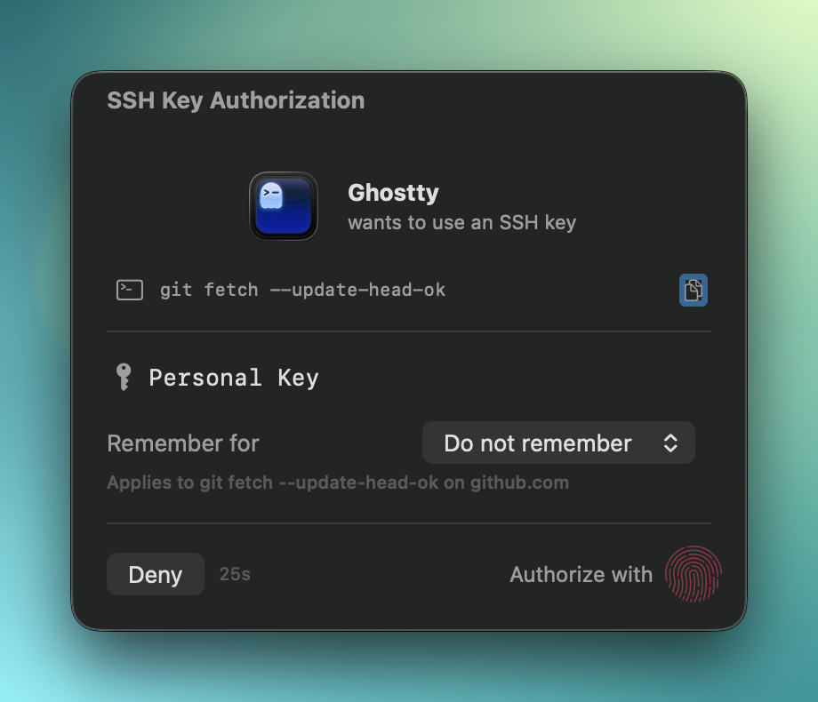
</p>

### Run Proxy

The Run Proxy lets the bundled `qa-run` helper inject Proton Pass secrets into command environments after Touch ID authorization.

Useful for tools that expect API tokens in environment variables, such as `gh`, deployment CLIs, or local development commands.

Read the setup guide: [Run Proxy and qa-run](docs/run-proxy.md)

<p align="center">
  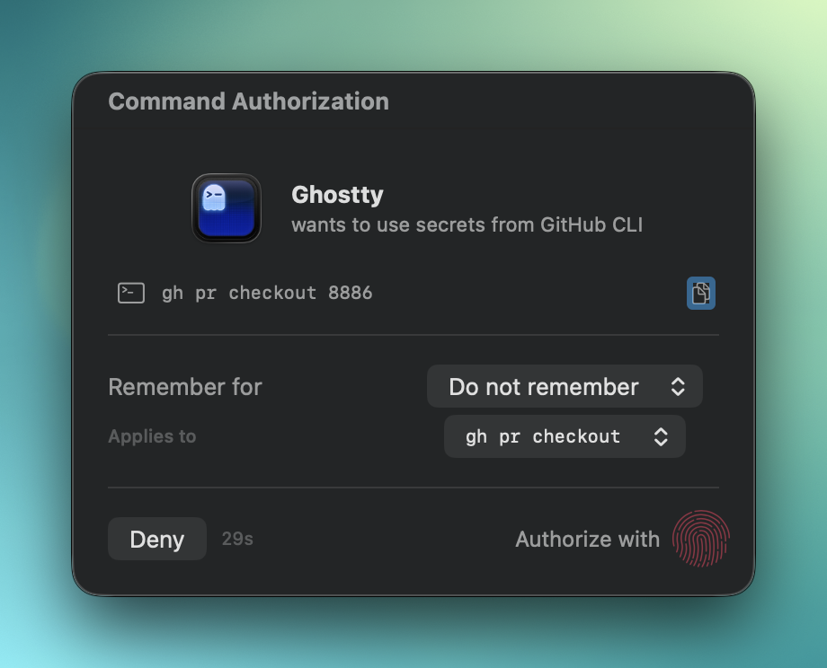
</p>

## Settings

**Settings → Integrations** configures supported-app presentation and custom terminal mappings shared by SSH and Run authorization prompts. Herdr is currently the only supported app with pane-details integration; it is detected automatically and enabled on first detection; you can rename or disable it, turn off **Show Herdr pane details**, or add a custom mapping. The editor accepts a pasted absolute or `~`-relative executable path, including paths with spaces, and also offers an optional file picker. Recording a path does not execute the file. Explicit opt-out and edits survive rediscovery and restart. Existing identified macOS apps keep their names and icons.

For Herdr, prompts may show the requesting pane's workspace/tab, a distinct title, and working directory. Empty titles and titles that are whitespace-equivalent to the displayed command are omitted using case-sensitive equality (not substring or prefix matching); this comparison does not alter either source value. This best-effort, untrusted context is display-only: it never changes authorization scopes or remembered decisions and does not establish ownership or permission evidence. No pane output, transcripts, or agent session files are read; unavailable or ambiguous metadata leaves the base prompt usable.

Most behavior is configurable in Settings: launch at login, global hotkey, shortcuts, clipboard clearing, sync cadence, Pass CLI source/version, security preferences, and optional SSH/Run proxy settings.

<table>
  <tr>
    <td align="center">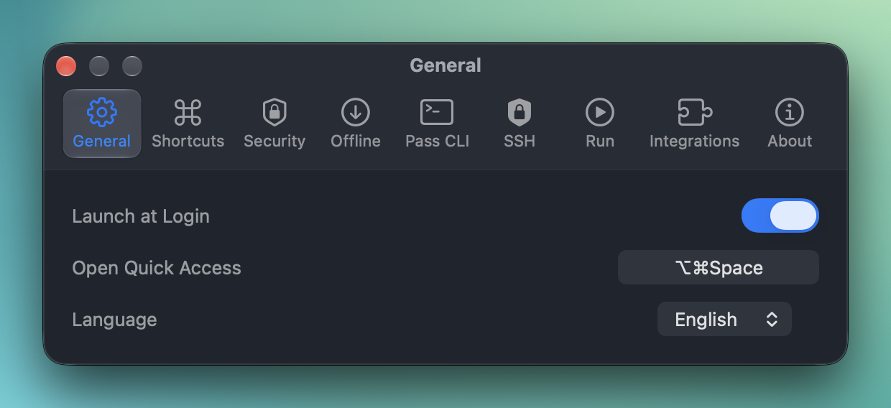<br><sub>General: launch at login, Quick Access hotkey, language</sub></td>
    <td align="center">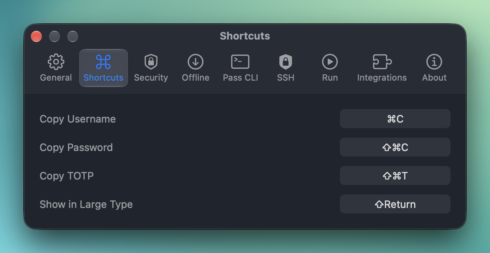<br><sub>Shortcuts: customize copy and Large Type shortcuts</sub></td>
  </tr>
  <tr>
    <td align="center">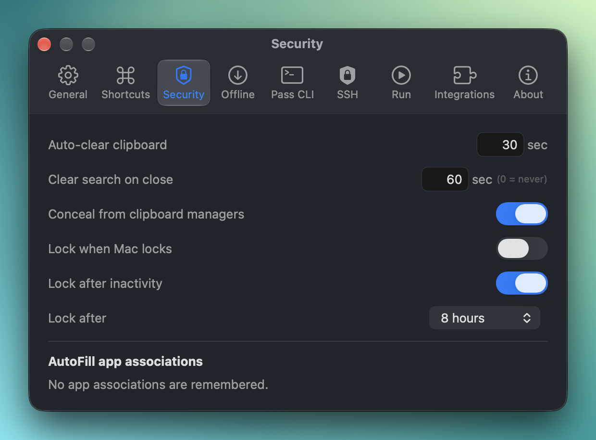<br><sub>Security: clipboard handling, search clearing, auto-lock</sub></td>
    <td align="center">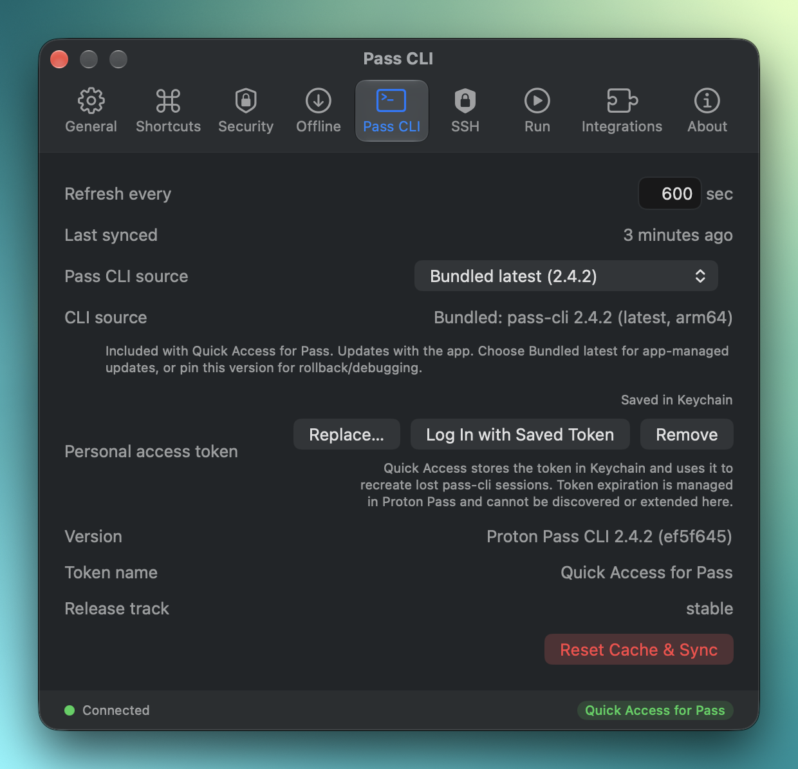<br><sub>Pass CLI: sync cadence, status, and source/version</sub></td>
  </tr>
  <tr>
    <td align="center">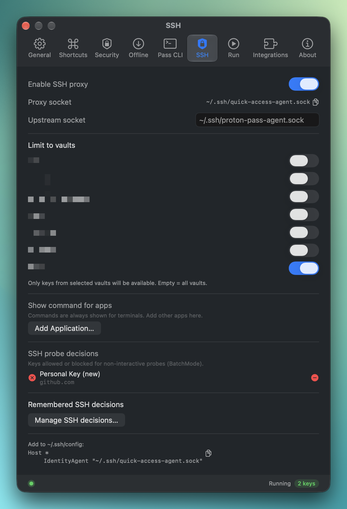<br><sub>SSH: proxy enablement, socket paths, filtering, remembered decisions</sub></td>
    <td align="center">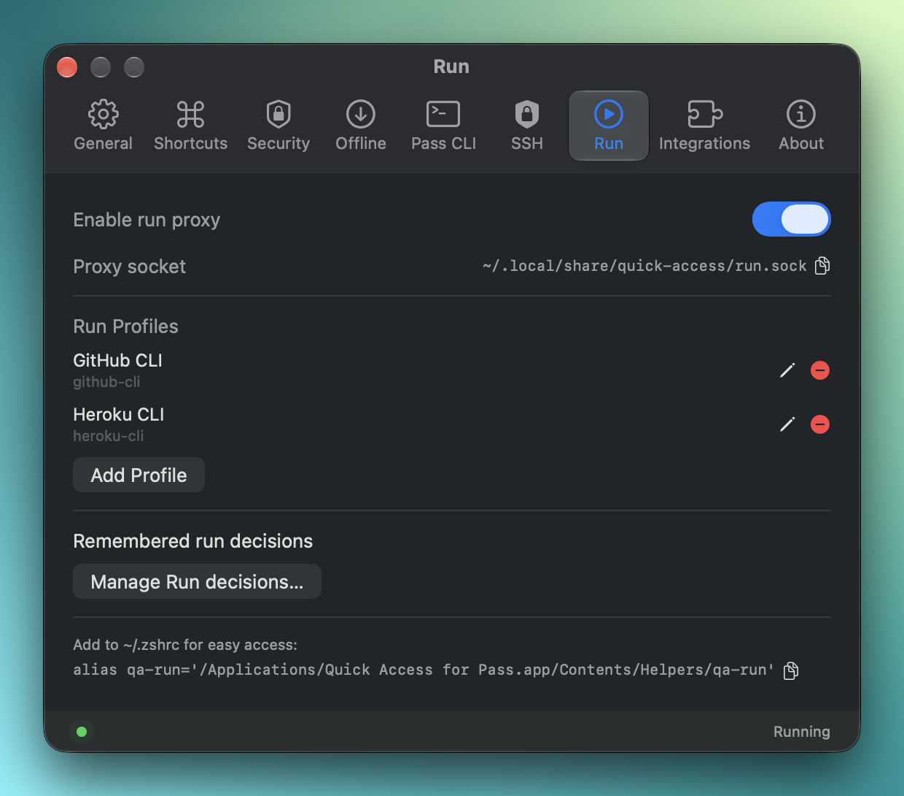<br><sub>Run: proxy enablement and secret-injection profiles</sub></td>
  </tr>
</table>

## Requirements

- macOS 15 or later for the menu-bar app; System AutoFill requires macOS 27 or later
- A paid Proton Pass subscription with Pass CLI access
- Touch ID for biometric prompts

Signed app releases include Proton's official Pass CLI fallback. A separate `pass-cli` install is optional.

## Advanced docs

- [Troubleshooting](docs/troubleshooting.md) — sync diagnostics, skipped items, and direct `pass-cli` inspection commands.
- [Proton Pass CLI integration](docs/pass-cli.md) — bundled CLI, CLI selection order, PAT support, provenance, and checksum verification.
- [SSH Agent Proxy](docs/ssh-agent-proxy.md) — Touch-ID-gated SSH signing setup and behavior.
- [Run Proxy and qa-run](docs/run-proxy.md) — command secret injection setup and behavior.
- [Backup and restore scripts](scripts/README.md) — same-Mac rollback instructions and Keychain limitations.
- [Security policy](SECURITY.md) — vulnerability reporting and security posture summary.

## Why this exists

I built this for myself and my wife after moving from 1Password to Proton Pass — and as a way to learn Swift and macOS development. If it is useful to you too, that is a nice bonus.

💛 **Like this project?** You can [sponsor it on GitHub](https://github.com/sponsors/CiTroNaK), or sign up for Proton with my [referral link](https://pr.tn/ref/DRHZ4WW3) — you get 2 weeks of a paid plan, and I get a small reward if you subscribe.

## Building from source

```bash
make build      # Release build
make install    # Build, inject bundled CLI helpers, copy to /Applications, and launch
xcodebuild -scheme "Quick Access for Pass" -configuration Debug build
xcodebuild -scheme "Quick Access for Pass" test
```

Requires Xcode 26+.

## Contributing

Contributions welcome.

- [CONTRIBUTING.md](CONTRIBUTING.md) — workflow and expectations
- [AGENTS.md](AGENTS.md) — guidance for coding agents

## Disclaimer

Not affiliated with, endorsed by, or associated with Proton AG. Proton Pass is a trademark of Proton AG.

## License

[MIT](LICENSE)

Uses [SQLCipher](https://www.zetetic.net/sqlcipher/) (BSD), [GRDB.swift](https://github.com/groue/GRDB.swift) (MIT), and bundled copies of Proton's official [Proton Pass CLI](https://github.com/protonpass/pass-cli) release binaries (GPL-3.0). See [Proton Pass CLI integration](docs/pass-cli.md) for bundled CLI version, source, and checksums.
