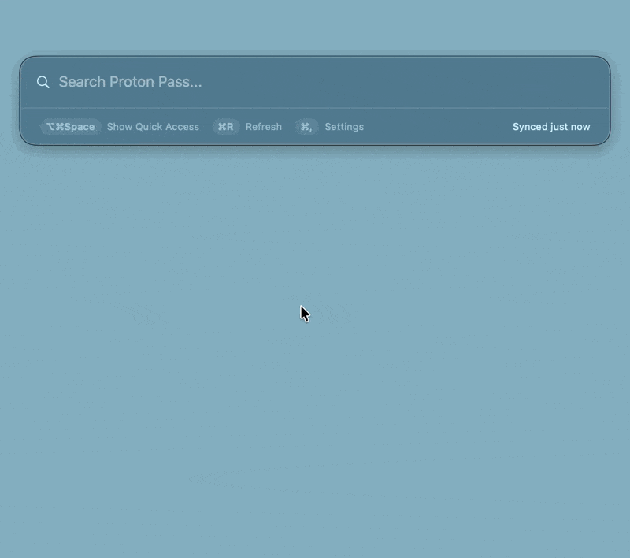
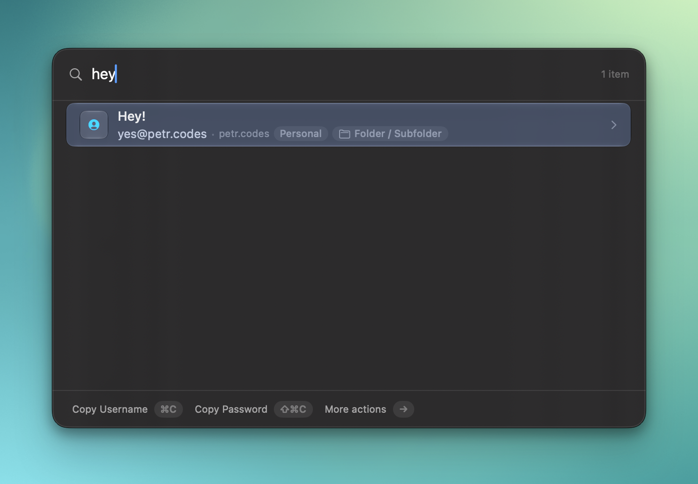
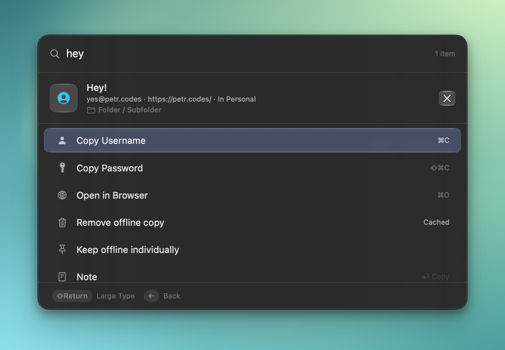
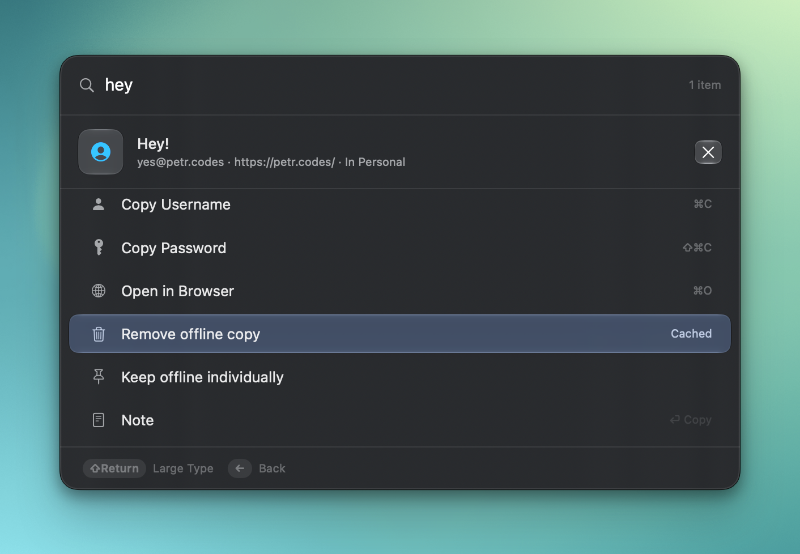
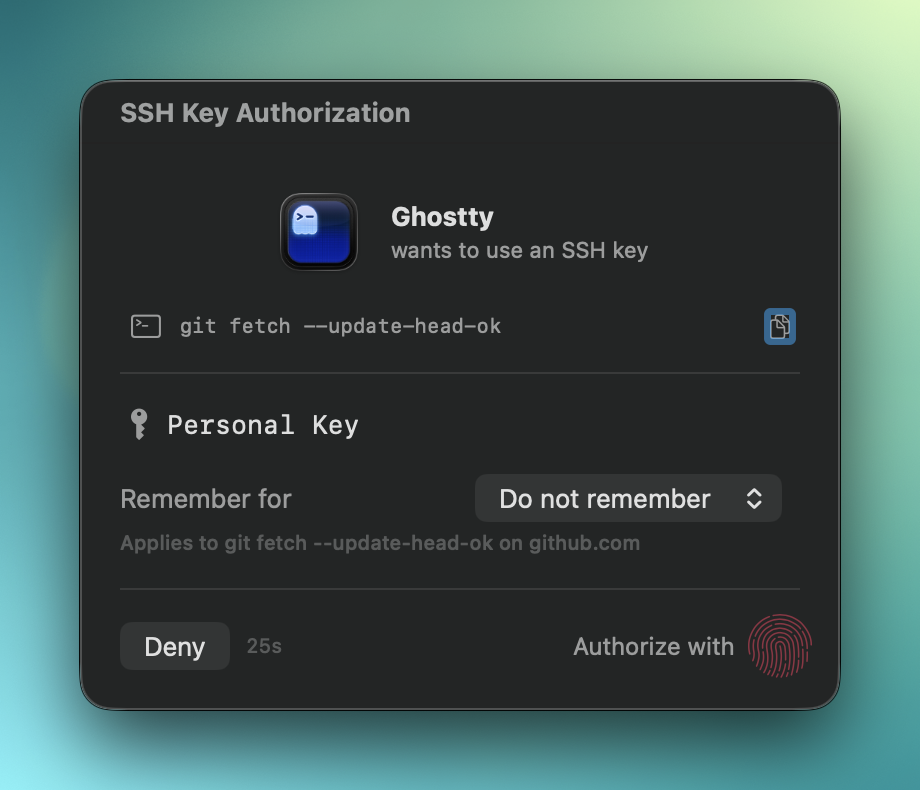
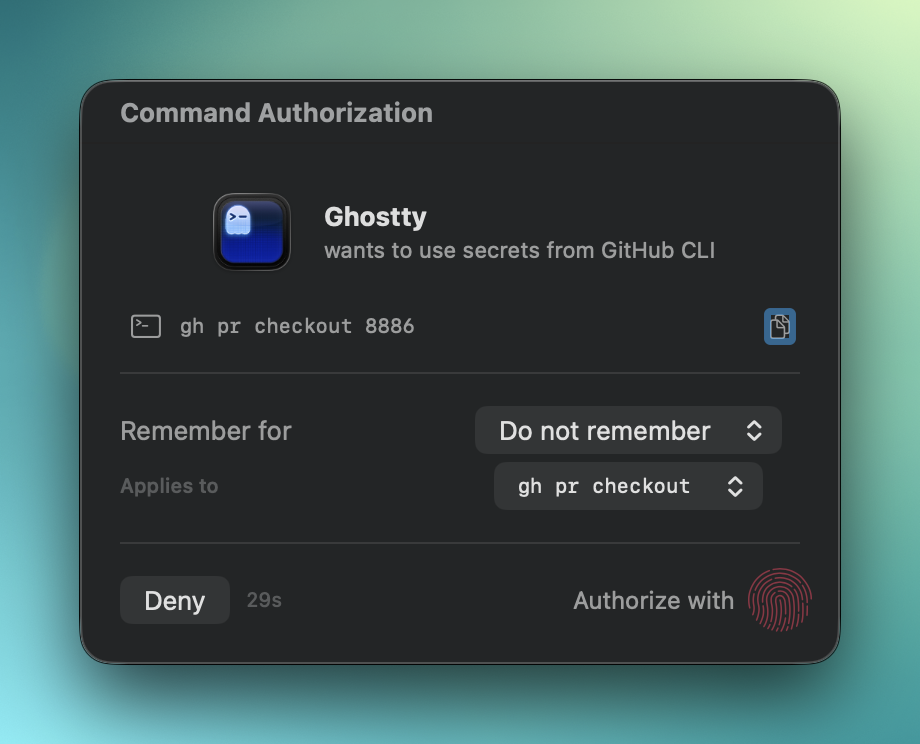

# Quick Access for Pass

**Search Proton Pass, copy what you need, and get back to what you were doing.**

Quick Access for Pass brings your [Proton Pass](https://proton.me/pass) passwords, usernames, and verification codes to a keyboard-first macOS menu-bar app. Press `⇧⌥Space`, type a few letters, and copy a value without opening the Proton Pass app.

Built with Swift, with Touch ID protection, clipboard auto-clear, and optional offline access. Free and open source.

[Download the app](https://github.com/CiTroNaK/Quick-Access-for-Pass/releases) · [Get started](docs/get-started.md) · [Contribute](CONTRIBUTING.md)

<p align="center">
  
</p>

## Why Quick Access?

- Search from any app with a global hotkey and navigate results from the keyboard.
- Copy passwords, usernames, alias addresses, TOTP codes, URLs, and individual fields.
- Read a selected value in Large Type when you need it on another device.
- Keep selected items or whole vaults available offline on your Mac.
- Fill passwords and verification codes in Safari and compatible apps with optional System AutoFill.
- Authorize SSH signing and command-line secret injection with the optional SSH and Run proxies.

Use just the search panel, or enable the integrations that suit you. There is no shell setup required for the main app.

## Get started

1. Download the signed app from [GitHub Releases](https://github.com/CiTroNaK/Quick-Access-for-Pass/releases).
2. Open the DMG and drag **Quick Access for Pass** to `/Applications`.
3. Open the app and sign in to Proton Pass when prompted.
4. Press `⇧⌥Space` to find your first item.

Signed releases include Proton's official Pass CLI. You do not need to install it separately.

Prefer Homebrew?

```bash
brew install CiTroNaK/tap/quick-access-for-pass
```

You need macOS 15 or later and a paid Proton Pass subscription with Pass CLI access. Biometric prompts require Touch ID. System AutoFill requires macOS 27 or later.

The [setup guide](docs/get-started.md) covers login, your first copy, and optional integrations.

## Search and copy

Find an item, press `Return` for its primary action, or press `→` to choose a field. Use `⇧Return` to show a value in Large Type.

Search stays available when sync needs attention. **Login** restores a missing CLI session, and **Show sync errors** opens diagnostics without closing search.

The default shortcuts are:

| Action | Shortcut |
| --- | --- |
| Open or close Quick Access | `⇧⌥Space` |
| Select a result | `↑` or `↓` |
| Open item detail | `→` |
| Go back | `←` |
| Run the selected action | `Return` |
| Copy username | `⌘C` |
| Copy password | `⇧⌘C` |
| Copy TOTP | `⌥⌘C` |
| Open in browser | `⌘O` |
| Show in Large Type | `⇧Return` |

**Settings → Shortcuts** contains the configurable action shortcuts.

<p align="center">
  
  
</p>

Folder paths stay visible in search results and item details with verified support from the actively selected Pass CLI 2.5.0 or newer. Folder names do not affect search matching.

## Offline Mode

Keep the items you need available when you cannot reach Proton Pass. Choose individual items, a whole vault, or a folder recursively in **Settings → Offline**. Vault and folder selection include future items after successful complete sync. Folder selection follows stable identities, including moves into or out of a selected subtree after sync. Removing an item excludes it until re-selection; turning off a vault or parent folder keeps independent child-folder and individual selections.

Folder features require the **actively selected Pass CLI 2.5.0 or newer** and verified support. Quick Access keeps its vault label and adds a separate folder-path label in results and a compact read-only path beneath the item detail subtitle; root or unresolved items have no folder label. Folder names do not affect search matching, ranking, or filtering, and SSH filtering remains vault-only. With an older, unknown, or checking CLI, new folder selection/discovery is disabled, but existing authorized offline copies, explicit policy removal, and purge remain available.

**Manage folders…** opens a fixed-size, scrollable folder manager from each compact vault row in Offline Settings. It includes a vault picker, local folder filter, and **Selected only** coverage view. Checkbox changes apply immediately; **Done** only closes the manager. The local folder filter does not change Quick Access or item-manager search.

Authorized, usable copies support copy and Large Type without a live request or connectivity probe. Sync refreshes them. Without a usable copy, the app uses Pass CLI. **Settings → Offline** lets you review selected items, retry a refresh, remove one copy, or remove all offline data.

Full fetched secrets persist only in the encrypted `offlineSnapshots` table in the host-only database, protected by a separate device-bound Keychain key. Offline Mode uses the existing app authorization policy without adding a hardware or biometric requirement.

System AutoFill can request an offline password or TOTP value through the verified host broker. The extension receives no cache access or fallback diagnostics. SSH and Run proxies never use offline copies.

Copies are tied to this Mac. Deletion retains the key, and backup exclusion and WAL checkpointing do not guarantee secure erasure or portable restore. See [Offline Mode](docs/offline-mode.md) for everyday behavior and the [security policy](SECURITY.md#offline-storage-lifecycle-and-limits) for storage limits.

<p align="center">
  
</p>

## Optional integrations

For passwords in the browser or secrets in your development tools, Quick Access also offers these optional integrations:

- [System AutoFill](docs/autofill.md) supplies passwords and current TOTP codes to Safari and compatible native apps. Quick Access does not handle passkeys.
- [SSH Agent Proxy](docs/ssh-agent-proxy.md) requires authorization for Proton Pass SSH signing unless a cached decision applies.
- [Run Proxy and `qa-run`](docs/run-proxy.md) injects configured secrets into command environments after authorization.
- [Terminal-host context](docs/terminal-hosts.md) describes custom terminal names and Herdr pane details in SSH and Run prompts. The details never change authorization.

<p align="center">
  
  
</p>

## Settings

Right-clicking the menu-bar icon opens a menu with **Settings…**. In the panel, `⌘,` opens Settings. Left-clicking the icon toggles the panel.

Settings includes launch at login, language, shortcuts, clipboard clearing, auto-lock, sync cadence, CLI selection, Offline Mode, and optional integrations. Terminal mappings are in **Settings → Integrations**.

## Security

Quick Access keeps search metadata in an encrypted local database and fetches live secrets through Proton's official CLI. Selected offline copies are the only persisted exception for fetched item content. Remembered Run command text is a separate exception and can contain credentials supplied in arguments.

Touch ID protection, auto-lock, concealed clipboard entries, and automatic clearing help limit everyday exposure. Local proxies use owner-only sockets, Run rejects unverified peers, and AutoFill authenticates both ends of its connection.

Security has limits. These controls cannot protect secrets from a compromised trusted process on an unlocked Mac. The [security policy](SECURITY.md) explains authorization, encryption, backup and deletion limits, and private vulnerability reporting.

## Documentation

The main guides are:

- [Get started](docs/get-started.md)
- [Troubleshoot login and sync](docs/troubleshooting.md)
- [Proton Pass CLI reference](docs/pass-cli.md)
- [Offline Mode reference](docs/offline-mode.md)
- [System AutoFill reference](docs/autofill.md)
- [Backup and deletion limits](SECURITY.md#backup-and-deletion)
- [Contribute and build from source](CONTRIBUTING.md)
- [Coding-agent instructions](AGENTS.md)

## About the project

I built Quick Access for myself and my wife after moving from 1Password to Proton Pass. It started as a way to make our daily password use more convenient and to learn Swift and macOS development. I hope it makes your Mac a little more useful, too.

Bug reports, ideas, documentation improvements, and code contributions are welcome. The [contributor guide](CONTRIBUTING.md) explains how to build the app and send a pull request.

If you find Quick Access useful, you can [sponsor the project](https://github.com/sponsors/CiTroNaK). My [Proton referral link](https://pr.tn/ref/DRHZ4WW3) gives you two weeks of a paid plan and gives me a reward if you subscribe.

Quick Access is not affiliated with or endorsed by Proton AG. Proton Pass is a trademark of Proton AG.

## License

Quick Access uses the [MIT license](LICENSE). It uses [SQLCipher](https://www.zetetic.net/sqlcipher/) under BSD and [GRDB.swift](https://github.com/groue/GRDB.swift) under MIT. Bundled [Proton Pass CLI](https://github.com/protonpass/pass-cli) binaries use GPL-3.0. The [CLI provenance reference](docs/pass-cli.md#provenance) lists their sources and checksums.
