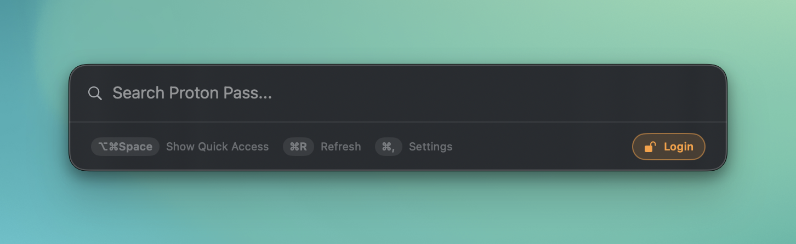

# Install Quick Access and sign in

Use this guide to install the app and copy your first value from Proton Pass. You need macOS 15 or later and a paid Proton Pass subscription with Pass CLI access.

## Install the app

1. Download the signed DMG from [GitHub Releases](https://github.com/CiTroNaK/Quick-Access-for-Pass/releases).
2. Open the DMG.
3. Drag **Quick Access for Pass** to `/Applications`.
4. Open the app.

The app appears in the menu bar. Signed releases include Proton's official Pass CLI, so you do not need a separate CLI installation.

If you manage apps with Homebrew, use this command instead:

```bash
brew install CiTroNaK/tap/quick-access-for-pass
```

Use your normal Homebrew update workflow for later releases.

## Sign in to Proton Pass

1. Click **Log In** in the login notification.
2. Complete Proton's browser login.

If the notification is unavailable, open the Quick Access panel and press `⌘,`. In **Settings → Pass CLI**, select **Log In to Proton Pass CLI…**.

The panel also shows **Login** in its sync-status area when the CLI needs a session.

<p align="center">
  
</p>

For a saved personal access token or an unreadable CLI session, see [Pass CLI authentication behavior](pass-cli.md#personal-access-token-support).

## Copy a value

1. Press `⇧⌥Space` to open Quick Access.
2. Type an item title or other search text.
3. Use `↑` or `↓` to select a result.
4. Press `Return` to run its primary action.

To choose a field, press `→` to open the item details. Press `⇧Return` on a value to show it in Large Type.

The [shortcut reference](../README.md#search-and-copy) lists the default keys. Change action shortcuts in **Settings → Shortcuts**.

## Enable optional integrations

For offline access, select **Make available offline** on an item or select a vault in **Settings → Offline**. A whole-vault selection also covers future items after successful sync. See [Offline Mode](offline-mode.md) for exclusions and removal limits.

For System AutoFill on macOS 27 or later:

1. Open **System Settings → General → AutoFill & Passwords**.
2. Enable AutoFill.
3. Enable **Quick Access for Pass** as a provider.

Keep Proton Pass enabled if you use its passkeys. Quick Access supplies passwords and TOTP codes, not passkeys. See [System AutoFill](autofill.md) for picker behavior.

Follow the separate guides to [enable SSH signing authorization](ssh-agent-proxy.md) or [inject secrets into commands with `qa-run`](run-proxy.md).

## Resolve login or sync problems

If the panel shows **Show sync errors**, open that window and review the affected items. Use [Troubleshoot login and sync](troubleshooting.md) before sharing diagnostics or changing stored items.
