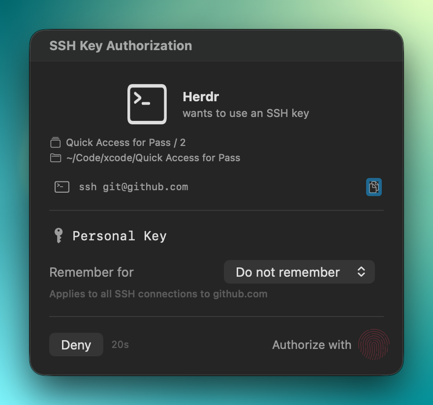

# Terminal-host context

**Settings → Integrations** controls the terminal names and Herdr details shared by SSH and Run authorization prompts. These values describe the requester. They never grant permission or change remembered decisions.

## Host discovery and mappings

Herdr and Herdr Core are the only supported apps with pane-detail lookup. Herdr is detected at startup and in captured requester ancestry, including nonstandard installations, and first detection enables its entry. Herdr Core needs no discovery or entry; see [Herdr Core](#herdr-core).

Settings supports a display name, an enable switch, and **Show workspace, pane title and directory**. Explicit opt-out and name edits survive rediscovery, restart, and a temporarily unavailable installation.

**Add Custom Terminal…** records an executable-to-display-name mapping. The editor accepts an absolute or `~`-relative path, including spaces, and offers an optional **Choose…** picker. Recording a path does not execute the file. Discovery and custom mappings never launch candidate executables.

A custom mapping of the same executable suppresses automatic Herdr activation even when that mapping is disabled. An identified macOS app takes precedence over a path mapping and keeps its name and icon.

## Details in a prompt

A matched Herdr request can show the workspace or tab, a distinct pane title, and the working directory. Empty titles are omitted. A title equal to the displayed command after whitespace comparison is also omitted. The comparison is case-sensitive and checks equality, not prefixes or substrings. The original command and title remain unchanged.

The base prompt and countdown appear without waiting for details. Each displayed eligible prompt gets at most one lookup, with one absolute 750 ms deadline. Cache-covered requests do not create a lookup.

Missing, ambiguous, stale, disabled, cancelled, or slow context leaves the base prompt usable. Configuration changes clear displayed details and cancel active lookup work. Metadata remains in memory for that request and is not persisted or included in audit logs.

  

## Herdr Core

Herdr Core (`hc`) is a separate product from classic Herdr, and its support is automatic. There is nothing to map. **Settings → Integrations** shows where Herdr Core is installed: `~/.local/bin/hc`, otherwise `~/.local/bin/herdr-core`, otherwise the bundle in `~/.local/share/herdr-core/current`, otherwise a `Herdr Core.app` registered with macOS. This is display only; recognition relies on code signatures and has the same two switches as Herdr, both on by default. Turning off the enable switch stops the lookup and leaves the plain **Herdr Core** prompt. Turning off **Show workspace, pane title and directory** keeps the Herdr.app icon and does not ask Core for terminal details. In a prompt that is already open, turning Herdr Core off cancels its lookup and clears the icon and rows; turning details off clears the rows, and a lookup already in progress finishes only for the icon. Like Herdr, turning a switch back on does not refill a prompt that already looked up its context. When an SSH or Run request comes from a Herdr Core terminal, the prompt keeps the **Herdr Core** title and can add:

- the Herdr.app workspace and tab, for example `Quick Access for Pass / Tab Name`, when the terminal belongs to Herdr.app;
- the terminal's name, or its title when it has no name, hidden when it repeats the displayed command;
- the current folder of the program running in the terminal.

These are the same rows, in the same order, as classic Herdr.

If Herdr.app is installed and its code signature verifies, its icon replaces Core's blank one. The check skips bundle resources, and macOS can show a Finder custom icon, so the icon image itself is not covered by the signature; it is decoration, not identity. Otherwise a terminal symbol is shown. Nothing is requested from Herdr.app itself: the workspace and tab come from the `where` label that Herdr.app sets on the terminal, read from the same Core reply.

Context is shown only after the app verifies the Core process signatures and Core confirms that the requesting process belongs to that terminal. Any Core session works. Terminals on remote machines are not supported. The lookup follows the same deadline and fallback rules as classic Herdr.

## Authorization remains separate

Mappings and Herdr details are untrusted display context. They do not change bundle or team identifiers, SSH command and host context, key fingerprints, Run command scope, or profile scope. They do not establish process ownership or permission.

For the verified `qa-run` helper, authorization uses its parent attribution. The display snapshot can also use the helper's bounded ancestry and inherited routing hints. A detached helper's authorization identifier remains `unknown`, regardless of the terminal name shown. Run rejects unverified peers before looking up prompt context.

The SSH-only **Show command for apps** setting is separate from terminal-host details.

## Lookup limits

Classic Herdr lookup uses fixed read-only commands and only the routing hints `HERDR_SOCKET_PATH` and `HERDR_PANE_ID`. It checks a local user-owned socket, requester shell PID, ancestry and start times, and the final process, socket, and pane association. Those checks provide point-in-time consistency, not atomic ownership proof.

Each command has a 512 KiB output cap. A lookup scans at most 32 panes and runs at most four process-info calls concurrently. It never reads pane output, transcripts, agent session files, or unrelated environment values. Inherited application routing is neutralized.

Herdr Core lookup executes no binary. It sends one read-only `terminal.get` request to the socket named by `HC_TERMINAL_SOCKET`, after verifying the socket's peer as Herdr Core. It uses only the `HC_TERMINAL_ID` and `HC_TERMINAL_SOCKET` routing hints.

The [terminal-host security boundary](../SECURITY.md#terminal-host-presentation-boundary) describes these limits alongside authorization and cancellation behavior.
