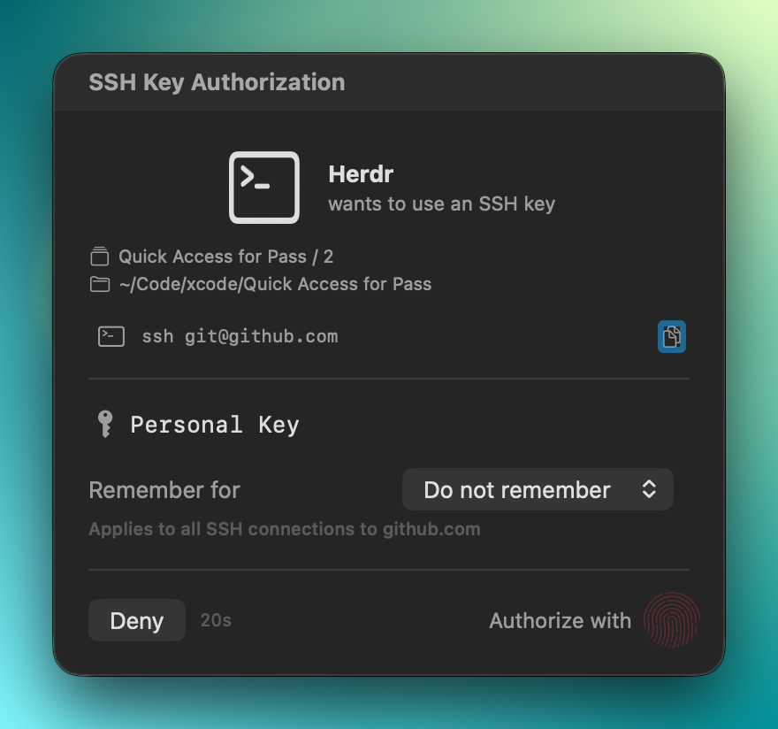

# Terminal-host context

**Settings → Integrations** controls the terminal names and Herdr details shared by SSH and Run authorization prompts. These values describe the requester. They never grant permission or change remembered decisions.

## Host discovery and mappings

Herdr is the only supported app with pane-detail lookup. The app detects it at startup and in captured requester ancestry, including nonstandard installations. First detection enables its entry.

Settings supports a display name, an enable switch, and **Show workspace, pane title and directory**. Explicit opt-out and name edits survive rediscovery, restart, and a temporarily unavailable installation.

**Add Custom Terminal…** records an executable-to-display-name mapping. The editor accepts an absolute or `~`-relative path, including spaces, and offers an optional **Choose…** picker. Recording a path does not execute the file. Discovery and custom mappings never launch candidate executables.

A custom mapping of the same executable suppresses automatic Herdr activation even when that mapping is disabled. An identified macOS app takes precedence over a path mapping and keeps its name and icon.

## Details in a prompt

A matched Herdr request can show the workspace or tab, a distinct pane title, and the working directory. Empty titles are omitted. A title equal to the displayed command after whitespace comparison is also omitted. The comparison is case-sensitive and checks equality, not prefixes or substrings. The original command and title remain unchanged.

The base prompt and countdown appear without waiting for details. Each displayed eligible prompt gets at most one lookup, with one absolute 750 ms deadline. Cache-covered requests do not create a lookup.

Missing, ambiguous, stale, disabled, cancelled, or slow context leaves the base prompt usable. Configuration changes clear displayed details and cancel active lookup work. Metadata remains in memory for that request and is not persisted or included in audit logs.

  

## Authorization remains separate

Mappings and Herdr details are untrusted display context. They do not change bundle or team identifiers, SSH command and host context, key fingerprints, Run command scope, or profile scope. They do not establish process ownership or permission.

For the verified `qa-run` helper, authorization uses its parent attribution. The display snapshot can also use the helper's bounded ancestry and inherited routing hints. A detached helper's authorization identifier remains `unknown`, regardless of the terminal name shown. Run rejects unverified peers before looking up prompt context.

The SSH-only **Show command for apps** setting is separate from terminal-host details.

## Lookup limits

Herdr lookup uses fixed read-only commands and only the routing hints `HERDR_SOCKET_PATH` and `HERDR_PANE_ID`. It checks a local user-owned socket, requester shell PID, ancestry and start times, and the final process, socket, and pane association. Those checks provide point-in-time consistency, not atomic ownership proof.

Each command has a 512 KiB output cap. A lookup scans at most 32 panes and runs at most four process-info calls concurrently. It never reads pane output, transcripts, agent session files, or unrelated environment values. Inherited application routing is neutralized.

The [terminal-host security boundary](../SECURITY.md#terminal-host-presentation-boundary) describes these limits alongside authorization and cancellation behavior.
